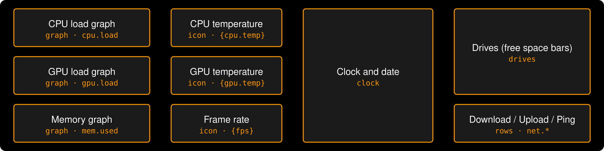
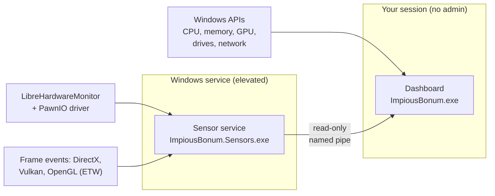

# Impious Bonum user guide

Everything Impious Bonum does and how to set it up. New here? Start with [Getting started](#getting-started). Every widget's settings, defaults and ranges are in the [widget reference](widgets.md).

## Contents

- [Getting started](#getting-started): [installing](#installing), [the tray menu](#tray-menu), [windowed mode](#windowed-mode)
- [Layouts and the editor](#layouts-and-the-editor): [the default layout](#the-default-layout), [the editor](#layout-editor), [editing by hand](#editing-layouts-by-hand), [sharing](#sharing-layouts), [the gallery](#layout-gallery), [pages](#pages)
- [What it shows](#what-it-shows): [metrics](#metrics), [the sensor service](#sensor-service-temperatures-fans-power-fps), [weather](#weather), [calendar](#calendar), [news](#news), [custom data](#custom-data), [Claude usage](#claude-usage)
- [Widgets in depth](#widgets-in-depth): [top apps](#top-apps), [multi-line graphs](#multi-line-graphs), [world clocks](#world-clocks), [timers](#timers), [now playing and buttons](#now-playing-and-buttons), [audio visualiser](#audio-visualiser), [images and shapes](#images-and-shapes)
- [Automatic behaviour](#automatic-behaviour): [alerts](#alerts), [hotkeys](#hotkeys), [game layouts](#game-layouts), [session recaps](#session-recaps), [schedule](#schedule), [dimming](#dimming), [logging](#logging)
- [More screens](#more-screens): [more dashboards](#more-dashboards), [tablet view](#tablet-view), [USB screens](#usb-screens)
- [Command line](#command-line)

## Getting started

### Installing

Download [`ImpiousBonum-win-Setup.exe`](https://github.com/ChaoDjinn/ImpiousBonum/releases/latest/download/ImpiousBonum-win-Setup.exe) from the [latest release](https://github.com/ChaoDjinn/ImpiousBonum/releases/latest) and run it.

- It installs for your user only (no admin prompt) into `%LocalAppData%\ImpiousBonum`, adds Start menu and desktop shortcuts, and installs the .NET 10 Desktop Runtime first if you don't have it.
- On first run it fills your smallest secondary monitor. With only one screen it starts as a window on it instead (see [Windowed mode](#windowed-mode)), so it doesn't cover everything else. Use the tray icon to move it to another display, edit the layout, or turn on *Start with Windows*.
- The app checks GitHub for updates about a minute after it starts and every six hours after that; tray → *Check for updates* checks right away. New versions download in the background (usually as a small delta) and the tray offers *Restart to update to x.y.z*. The tray menu's first line shows the installed version.
- After an update, if the sensor service is from an older version the tray says so; *Sensors → Update sensor service…* brings it up to date.
- Uninstall from Windows Settings → Apps. It removes start-with-Windows and offers to remove the sensor service (one UAC prompt). Your layout and settings in `%AppData%\ImpiousBonum` are kept.
- The installer isn't code-signed yet, so Windows SmartScreen may warn the first time: choose *More info → Run anyway*.

Settings and layouts live in `%AppData%\ImpiousBonum`:

- `layouts\<name>.json`: your saved layouts (canvas size, theme and widgets), one file each. The dashboard shows one at a time; saved changes to it apply immediately. Upgrading from a version with a single `layout.json` moves it to `layouts\Default.json`, hand edits and all.
- `themes\<name>.json`: your saved themes (font, colours, gradients, glow and background), which any layout can use by name.
- `settings.json`: the weather location and units (`weatherLocation`, `weatherUnits`), [pages](#pages) (`swipePages`, `rotatePagesSeconds`, `pages`), [alerts](#alerts) (`alerts`), [custom data](#custom-data) (`customData`), the [schedule](#schedule) (`schedule`, `scheduleEnabled`), [dimming when away](#dimming) (`awayDimMinutes`, `awayBrightness`), which monitor, how the window behaves (`fill`, `area`, `locked`, `clickThrough`, `alwaysOnTop`, `hideOverFullscreen`), which layout (`activeLayout`), ping host, the tablet view (`tabletView`, `tabletPort`, `tabletToken`, `tabletButtons`), a [USB screen](#usb-screens) (`usbScreen`), [hotkeys](#hotkeys) (`hotkeys`), [calendars](#calendar) (`calendars`), [news feeds](#news) (`newsFeeds`), [logging](#logging) (`logging`), [session recaps](#session-recaps) (`sessionRecaps`), the [gallery](#layout-gallery)'s address (`galleryAddress`), `hardwareRendering` (off by default to save memory).
- `claude-usage.json`: the plan usage Claude Code last reported (see [Claude usage](#claude-usage)).
- `dashboard.log`: startup, update checks and any errors. If something goes wrong, this is the file to attach to an issue (tray → *Open settings folder*).

### Tray menu

| Item | |
|---|---|
| *Display* | Which monitor the dashboard is on, and how its window behaves (see [Windowed mode](#windowed-mode)) |
| *Display → More dashboards* | Fill other screens with layouts of their own (see [More dashboards](#more-dashboards)) |
| *Display → When you're away* | Dim the dashboard, or turn it black, after a while without input (see [Dimming](#dimming)) |
| *Display → Tablet view* | Show the dashboard in a browser on a tablet or phone, and optionally let it press the layout's buttons (see [Tablet view](#tablet-view)) |
| *Display → USB screen* | Show a layout on a small USB screen as well (see [USB screens](#usb-screens)) |
| *Layout* | Which saved layout the dashboard shows. Switches straight away and is remembered |
| *Layout → Import…* | Add a layout from an exported `.ibl` file and show it (see [Sharing layouts](#sharing-layouts)) |
| *Layout → Gallery…* | Browse layouts other people have shared, with a live preview, and import one (see [Layout gallery](#layout-gallery)) |
| *Layout → Pages* | Swipe across the dashboard to move between layouts, or rotate them on a timer (see [Pages](#pages)) |
| *Layout → Game layouts* | Link the app you were just using to a layout, remove links, turn automatic switching on or off, and recap each session (see [Game layouts](#game-layouts) and [Session recaps](#session-recaps)) |
| *Layout → Schedule* | Show a layout or theme at certain times of day, or while Windows is in dark or light mode (see [Schedule](#schedule)) |
| *Sensors* | Sensor service status, and install, update or remove it |
| *Claude usage* | Whether Claude Code is reporting, and *Connect Claude Code…* (see [Claude usage](#claude-usage)) |
| *Weather* | The weather now, *Set location…*, units, and *Turn off weather* (see [Weather](#weather)) |
| *Alerts…* | Be told when a reading stays out of bounds (see [Alerts](#alerts)) |
| *Logging…* | Log readings to daily CSV files, with each one's average, lowest and highest (see [Logging](#logging)) |
| *News feeds…* | Feeds whose headlines the news widget shows (see [News](#news)) |
| *Calendar…* | Calendars whose events the agenda widget shows (see [Calendar](#calendar)) |
| *Hotkeys…* | Keys that show or hide the dashboard, turn pages, open the editor or switch layouts from anywhere (see [Hotkeys](#hotkeys)) |
| *Custom data…* | Your own metrics from web addresses and commands (see [Custom data](#custom-data)) |
| *FPS from* | Follow the foreground app, or the top app on a chosen monitor |
| *Edit layout…* | Open the layout editor (or double-click the tray icon) |
| *Open layout file*, *Open settings folder*, *Reload layout* | Work with the files directly (*Open layout file* opens the one being shown) |
| *Start with Windows* | Start the dashboard when you sign in |
| *Check for updates* | Installed copies only |

### Windowed mode

Without a spare screen, tray → *Display* → *Windowed* turns the dashboard into a window on the chosen monitor (on a PC with only one screen it starts this way). It starts unlocked with a dashed outline: drag it to move it (onto another monitor too) and drag an edge or corner to resize it. It keeps the layout's shape, so the layout always fills it. Then tick *Lock position*. Its size, position and monitor are remembered, and it's moved back on screen if the resolution changes.

- *Click-through when locked* lets clicks go to the window underneath. Right-click can't open the editor then; use the tray.
- *Always on top* keeps it above other windows. *Hide over fullscreen apps* (on by default) hides it while a game or video fills its monitor, since a window over a borderless game can cost frame pacing, and it can't show over exclusive fullscreen anyway.
- *Bring to front* raises it when it's behind other windows, and *Reset size and position* recentres it.
- The canvas scales to the window, so a small window shrinks everything evenly. For a window that isn't a strip, give the layout a matching size in the editor (*Canvas*); *Match dashboard screen* uses the window's size.

*Fill screen* goes back to covering the whole monitor.

## Layouts and the editor

### The default layout

Out of the box it fills a 1920×480 screen like this (any size works: the canvas scales to fit, and you can change the design size):

<p align="center"></p>

Every box is a widget you can move, resize, restyle or replace. Twenty-two widget types are available: `text`, `graph` (line or area history with a header), `lines` ([Multi-line graphs](#multi-line-graphs)), `stat` (a big value with a trend line and its lowest and highest), `gauge` (a dial: 270° arc, semicircle or ring), `cores` (every CPU thread's load as bars or a heatmap), `icon` (accent icon + value), `clock` (with other time zones too: [World clocks](#world-clocks)), `timer` ([Timers](#timers)), `drives`, `processes` (the apps using the most CPU or memory, like a small Task Manager), `rows`, `bars` (labelled progress bars), `media` and `buttons` ([Now playing and buttons](#now-playing-and-buttons)), `visualizer` ([Audio visualiser](#audio-visualiser)), `weather` ([Weather](#weather)), `agenda` ([Calendar](#calendar)), `news` ([News](#news)), `image` and `shape` ([Images and shapes](#images-and-shapes)) and `claude` ([Claude usage](#claude-usage)). Every setting, its default and its range is in the [widget reference](widgets.md).

### Layout editor

Double-click the tray icon (or tray → *Edit layout…*, or right-click / press and hold on the dashboard) to open the editor on your main screen:

- **Preview:** click a widget to select it, drag to move, drag the handles to resize. Moves snap to a grid (toolbar); hold Alt to place freely. Arrow keys nudge, Shift+arrows by 10.
- **Metrics:** template and metric fields have a `{…}` button that opens a searchable list of every metric (about 280 on a typical PC, including every raw sensor) with live values. Pick one and choose how to show it (e.g. `18.7 GB`, `19,138 MB` or just `18.7`) and it's inserted at the cursor. Under each field a live preview shows what it renders now and flags unknown metric ids.
- **Properties:** every setting of the selected widget, with the right control for each (numbers, colours with a picker, fonts, drop-downs, lists) and a reset-to-default button. Click empty canvas or press Esc for canvas size and theme.
- **Setting a widget up:** the weather, agenda, news and Claude usage widgets need something set up outside the layout. Select one and *Set up*, at the top of its properties, says what's set up now and has a button for it: *Set location…*, *Calendars…*, *News feeds…* or *Connect Claude Code…*. They're the same as the tray's.
- **Widgets:** add, duplicate (Ctrl+D), delete, and bring forward / send back.
- **On the dashboard itself:** while the editor is open, the dashboard shows outlines and finger-sized handles. Tap a widget to select it, drag to move, drag a handle to resize; the editor follows along (and vice versa), with the same snapping and undo.
- **Themes:** with the canvas selected, *Theme* picks a saved theme for the layout, each shown with a sample of its colours. *Orange* (the default look) and 42 others are built in: clean ones like *High Contrast*, *Swiss* and *Glacier*, retro ones like *Amber*, *8-Bit*, *Desktop 95* and *Blue Screen*, moods like *Outrun*, *Cyberpunk*, *Grimoire*, *Aurora* and *Gatsby*, a *Night Watch* theme in dim reds for a screen you keep on at night, and well-known editor palettes such as *Dracula*, *Nord*, *Gruvbox*, *Solarized* and *Catppuccin*. Colours and fonts you change below it apply to this layout only (↺ goes back to the theme's value). *Save theme as…* keeps the current look as a new theme for other layouts, *Update theme* writes your changes into a theme of your own (restyling every layout that uses it), and *Detach* copies the theme's values into the layout so later changes to the theme don't affect it. Built-in themes can't be changed; *Save theme as…* makes your own copy.
- **Moving backgrounds:** the theme's background *Image* can be an animated GIF or a video (MP4, M4V or WMV), which plays muted and on a loop behind the widgets, with the same fit and opacity settings as a picture. GIF frames are prepared once at the size the canvas shows them and kept under 48 MB in all (a long GIF is made smaller, then thinned), and fast GIFs are held to 20 frames a second. A moving background stops while the dashboard is hidden. The tablet view and USB screens show a still frame. Moving backgrounds cost more CPU than a still picture, a video most of all, since the dashboard draws without the graphics card unless you turn hardware rendering on. Exported layouts carry a video up to 50 MB.
- **A widget's own look:** every widget has *Widget theme* settings (font, weight and the theme's colours) that override the layout's theme for that widget alone; leave them empty to follow the theme. Named colours in its other settings, like `accent`, then mean the widget's own. Many widgets also have colours of their own, such as a bar's track or *Now playing*'s progress bar, so changing the theme's bar track doesn't change everything that happens to use it.
- **Gradients and glow:** under *Gradients and glow* in the theme's settings, *Accent fades to* makes graphs, bars, gauges and icons fade from the accent to a second colour; *Background fades to* fades the background from top to bottom; and *Glow* (0 to 1) puts a soft neon halo around every widget's text and shapes, in the accent colour or its own. *Outrun*, *Vaporwave*, *Aurora*, *Magma*, *Cyberpunk* and *Toxic* use them. The glow costs a little CPU, since the dashboard draws without the graphics card by default.
- **Saved layouts:** the editor edits the layout the dashboard is showing. The *Layout* drop-down switches to another (asking first if you have unsaved changes), and *Layouts ▾* has *Save as…* (your changes as a new layout), *Rename…*, *Duplicate…*, *Export…*, *Import…* and *Delete* (not the last one). Keep a "Gaming" and a "Desktop" layout, for example, and flip between them from the tray.
- The real dashboard shows your changes live while you edit. **Save** (Ctrl+S) writes the layout's file; closing without saving puts the dashboard back as it was. Undo/redo with Ctrl+Z / Ctrl+Y.

<!-- Editor screenshot (Win+Shift+S): save as docs/images/editor.png, then remove these comment markers:
<p align="center"></p>
-->

### Editing layouts by hand

Each layout is a JSON file in `%AppData%\ImpiousBonum\layouts` (tray → *Open layout file* opens the one being shown). Saving the shown layout's file applies it straight away; changes to other layouts show when you switch to them. To add a layout by hand, drop a new `.json` file in the folder and pick it from tray → *Layout*.

The canvas has a design size (default 1920×480) and scales to fit the window. Each widget has `type`, `x`, `y`, `width`, `height` plus its own settings. Text uses templates:

```json
{ "type": "text", "x": 58, "y": 296, "width": 427, "height": 76, "fontSize": 64, "text": "{gpu.vram.used:N0 MB}" }
```

`{id}` formats automatically (`18.7 GB`, `11.8 %`, `79.7 KB/s`). After a colon you can add a number format (`0.0`, `N0`), force a byte unit (`MB`, `GB`, …) or write `nounit`. Readings that aren't available show as `—`.

To make a value change colour when it runs hot, give its `text`, `icon`, `graph` or `drives` widget warning colours (in the editor, or as `thresholds` in the layout file): `[{ "above": 80, "color": "warning" }, { "above": 90, "color": "critical" }]`. `warning` and `critical` are theme colours, and `below` works too, e.g. for a low frame rate.

If a layout has a typo or an out-of-range value, the tray shows a notification naming the file and saying what and where, e.g. *unknown setting 'fontsize' (did you mean 'fontSize'?)*.

A layout's `theme` can be its own values, a saved theme's name (`"theme": "Ice"`), or a saved theme with a few values changed for this layout: `"theme": { "base": "Ice", "accent": "#FF4081" }`. Saved themes are files in `%AppData%\ImpiousBonum\themes` holding the same settings; saving one restyles every layout that uses it straight away. An unknown theme name is reported like any other typo, and the layout falls back to the default look.

To use a font you don't want to install, point the theme at the file: `"fontFile": "C:\\Fonts\\SomeFont-Light.otf"`.

To put a picture behind the widgets, add `"backgroundImage": "C:\\Pictures\\wallpaper.jpg"` to the theme. `backgroundFit` is `fill` (the default: covers the canvas, cropping the edges), `fit`, `stretch`, `center` or `tile`, and `backgroundOpacity` below 1 lets the `background` colour show through, which dims a busy picture on black. The image is decoded at the canvas size, so a 4K wallpaper doesn't cost extra memory. If the file is missing the dashboard just shows the colour. The full list of theme settings is at the end of the [widget reference](widgets.md#theme).

### Sharing layouts

*Layouts ▾ → Export…* in the editor saves the layout you're editing as one `.ibl` file, with its font file, background image and image widgets' pictures inside, so it works on another PC. A layout using one of your saved themes takes the theme's values with it; built-in themes stay as names. *Import…* (in the editor, or tray → *Layout*) adds it to your saved layouts, asking before replacing one with the same name. The font and image go in `layouts\<name>\` and are removed when no layout uses them any more. Metrics the other PC doesn't have, such as a particular sensor, show `—` as usual.

A layout from someone else could have a harmless-looking button that runs any program, so if it has buttons that open something, the import lists what they'd open and asks whether to keep them or clear them.

An `.ibl` file is a zip of `layout.json`, `manifest.json` and an `assets` folder. Imports only take the layout and the font (`.ttf`, `.otf`) and images it names, reject a file with `..` or absolute paths in it, and cap sizes (1 MB for the layout, 50 MB per file).

### Layout gallery

Tray → Layout → *Gallery…* lists layouts people have shared, each with its screen size and a description. Pick one to
see it drawn live with your own readings, then *Import* adds it to your saved layouts and shows it, the same way as
importing a file: you're asked before a layout with the same name is replaced, and before keeping buttons that open
programs. Pictures and fonts inside a shared layout show once it's imported. It starts with a gaming HUD, a desk
companion (world clocks, calendar, weather, music), a system monitor, a focus timer and a layout for small 800 × 480
screens.

The gallery is the [`gallery`](../gallery) folder of this repository. To share a layout, export it (*Layouts ▾ →
Export…* in the editor), add the `.ibl` file and an entry in [`gallery/index.json`](../gallery/index.json), and open a
pull request. A plain layout `.json` works too if it has no pictures or fonts. The tests check every gallery layout
opens and is valid. To use a gallery of your own instead, set `"galleryAddress"` in `settings.json` to a web folder
with an `index.json` in it.

### Pages

A small strip fits more when it has pages. Tray → *Layout* → *Pages*:

- **Swipe between pages:** swipe left across the dashboard for the next layout, right for the previous one (a mouse drag works too). A row of dots shows which page you're on. A press that turns into a swipe doesn't count as a tap on a button.
- **Rotate:** move to the next page every 15 seconds to 5 minutes. Rotation waits a minute after you touch the dashboard, and doesn't run while you edit the layout or while a [game's layout](#game-layouts) is showing.
- **The pages are:** tick the layouts that are pages, in the *Layout* menu's order. With none ticked, every layout is a page.

Turning a page is the same as picking that layout from the tray, so it's remembered. Swiping is off while the window can be dragged (windowed and unlocked) and while you edit the layout. Stored as `swipePages`, `rotatePagesSeconds` and `pages` in `settings.json`.

## What it shows

### Metrics

| Metric ids | Source |
|---|---|
| `cpu.load`, `cpu.threads` | `GetSystemTimes` |
| `cpu.clock` (effective MHz, like Task Manager's *Speed*), `cpu.core.<N>.load` (each logical processor, from 0) | Processor performance counters |
| `mem.used`, `mem.total`, `mem.available`, `mem.load` | `GlobalMemoryStatusEx` |
| `mem.commit.used`, `mem.commit.total`, `mem.commit.load` (committed memory against RAM + page file) | `GlobalMemoryStatusEx` |
| `gpu.name`, `gpu.load`, `gpu.vram.used`, `gpu.vram.total`, `gpu.vram.free`, `gpu.vram.usedPct`, `gpu.shared.used` | GPU performance counters + DXGI (same numbers as Task Manager) |
| `gpu.load.3d`, `gpu.load.decode`, `gpu.load.encode`, `gpu.load.compute` | GPU engine counters, the busiest engine of each kind |
| `disk.<L>.free/used/total/usedPct/label` | `DriveInfo`, follows drives as they come and go |
| `disk.<L>.read/write/active`, `disk.read`, `disk.write` | Disk performance counters: speed per drive and in total, and % of time active |
| `disk.<L>.life`, `disk.<L>.temp`, `disk.<L>.status`, `disk.<L>.model`, `disk.<L>.hours` | Sensor service: the drive's health (life remaining %, like CrystalDiskInfo), temperature, status (Good / Caution / Bad), model and power-on hours, from its SMART data |
| `net.down`, `net.up`, `net.down.total`, `net.up.total`, `net.ip`, `net.adapter` | Adapters with a default gateway (totals count since the adapter connected) |
| `net.ping` | ICMP to `1.1.1.1` (configurable) |
| `sys.uptime`, `sys.name`, `sys.battery`, `sys.battery.status` | Windows; the battery ones only on PCs with a battery |
| `top.cpu.<N>`, `top.cpu.<N>.name`, `top.memory.<N>`, `top.memory.<N>.name` (N = 1 to 5) | The apps using the most CPU and memory, every 2 seconds, from one `NtQuerySystemInformation` call like Task Manager's. An app's processes count together (all of Chrome's are one); CPU is a share of the whole processor, memory is the private working set (Task Manager's *Memory* column) |
| `weather.temp`, `weather.feels`, `weather.high`, `weather.low`, `weather.condition`, `weather.humidity`, `weather.wind`, `weather.wind.direction`, `weather.rain`, `weather.sunrise`, `weather.sunset`, `weather.tomorrow.high`, `weather.tomorrow.low`, `weather.tomorrow.condition`, `weather.location` | [Open-Meteo](https://open-meteo.com) forecast for the place set in tray → *Weather*, every 15 minutes |
| `calendar.next.title`, `calendar.next.time`, `calendar.next.location`, `calendar.next.minutes`, `calendar.now.title`, `calendar.today`, `calendar.status` | Your calendars' iCal links, set in tray → *Calendar…*, every 15 minutes (see [Calendar](#calendar)) |
| `session.game`, `session.minutes`, `session.playing`, `session.<x>.avg/min/max` for `fps`, `low1` (1% low FPS), `cpu`, `gpu` (loads), `cputemp`, `gputemp` | The game session going on now, or the last one, for a game linked under *Game layouts* (see [Session recaps](#session-recaps)) |
| `news.title`, `news.source`, `news.age`, `news.status` | The newest headline from your news feeds, set in tray → *News feeds…*, every 15 minutes (see [News](#news)) |
| `custom.<source>.<field>`, `custom.<source>.status` | Your own: web addresses and commands set up in tray → *Custom data…* (see [Custom data](#custom-data)) |
| `media.title`, `media.artist`, `media.album`, `media.app`, `media.status`, `media.position`, `media.duration`, `media.progress` | What's playing, from Windows' media sessions (the media controls in the volume flyout): Spotify, browsers, Media Player and so on. No reading while nothing is playing |
| `cpu.temp`, `cpu.power`, `gpu.temp`, `gpu.hotspot`, `gpu.power`, `gpu.fan` | Sensor service (below) |
| `fps`, `fps.app` | Sensor service counts frames per app (like PresentMon/HWiNFO): DirectX, Vulkan and OpenGL, without hooking into the game; the tray's *FPS from* picks the foreground app or the top app on a chosen monitor |
| `fps.frametime`, `fps.frametime.max`, `fps.low1`, `fps.low01` | Sensor service, for the same app: average frame time, the slowest frame in the last second, and the 1% and 0.1% lows over the last 30 seconds (see [Frame times](#frame-times)) |
| `hw/...` (every sensor LibreHardwareMonitor finds: clocks, voltages, fans, per-core loads, …) | Sensor service. Run `ImpiousBonum.Sensors.exe list` to see the ids on your machine |
| `sensors.status` | Text describing the sensor service connection |
| `claude.session`, `claude.week`, `claude.session.resets`, `claude.week.resets`, `claude.status` | Your Claude plan's usage limits, from Claude Code's status line (see [Claude usage](#claude-usage)) |

### Sensor service (temperatures, fans, power, FPS)

Reading CPU temperatures needs admin rights and a kernel driver, so it lives in a separate process: `sensors\ImpiousBonum.Sensors.exe`, built on [LibreHardwareMonitor](https://github.com/LibreHardwareMonitor/LibreHardwareMonitor). The dashboard itself stays unelevated and receives readings over a read-only named pipe.



- **Install:** tray icon → *Sensors* → *Install sensor service…* (one UAC prompt). The host is copied to `Program Files\Impious Bonum\Sensors` and registered as an auto-start service, so there are no prompts at logon.
- **CPU temperatures** also need the signed [PawnIO](https://pawnio.eu) driver (`winget install namazso.PawnIO`). HWiNFO and FanControl install it too. GPU sensors work without it.
- The service only reads hardware while a dashboard is connected. Its log is in `%ProgramData%\ImpiousBonum\sensors.log`.
- For development: `ImpiousBonum.Sensors.exe run` serves from a console, and `list` prints every sensor. Both work unelevated with fewer sensors. `install` and `uninstall` (as admin) do what the tray items do.

#### Frame times

Average FPS hides stutter: a game can average 120 FPS and still hitch. The sensor service also times every frame of the app the FPS follows:

- `fps.frametime`: the average frame time, e.g. `8.3 ms`.
- `fps.frametime.max`: the slowest frame in the last second. Put it in a `graph` widget for a frame-time graph: a flat line is smooth, each spike is a stutter you felt.
- `fps.low1` and `fps.low01`: the 1% and 0.1% lows, the frame rate of the slowest 1% (or 0.1%) of frames over the last 30 seconds. A 1% low close to the average means smooth play. They appear once there are enough frames (100, and 1,000). Pauses longer than a second, like alt-tabbing or a loading screen, don't count.

A sensor service from before 0.8 doesn't send these; *Sensors → Update sensor service…* brings it up to date.

### Weather

The *Weather* widget shows an icon, the temperature and conditions now (with today's high and low and what it feels like), and a row of the days or hours ahead, every three hours if you like. Every `weather.*` metric works in other widgets too: `{weather.temp} · {weather.condition}` in a text widget, or a gauge of `weather.temp`.

1. Tray → *Weather* → *Set location…*, or in the editor select the widget and *Set location…* under *Set up* (adding the widget offers it too). Search for your town, or type latitude and longitude, e.g. `51.5, -0.12`.
2. Add the widget: *Edit layout…* → add *Weather*.

It's adjustable in the editor: turn off *Weather now* to leave just the forecast (say, one widget of the hours ahead beside another of the days), choose *colour* icons for a yellow sun, white clouds, grey rain clouds with blue rain and white lightning instead of outlines in one colour, and give the widget its own text and detail colours rather than the theme's.

The location is set once for the PC, so every layout shows the same place. Units follow your Windows region (°C and km/h, or °F and mph); tray → *Weather* → *Units* changes them.

Forecasts come from [Open-Meteo](https://open-meteo.com), which is free for non-commercial use and needs no account. The coordinates of the place you pick go to Open-Meteo every 15 minutes, and the name you search for when you search; nothing else is sent, and nothing at all until you set a location. *Turn off weather* forgets the place and stops it. If the internet is down the last forecast stays for up to three hours. Weather data by Open-Meteo.com, under [CC BY 4.0](https://creativecommons.org/licenses/by/4.0/).

### Calendar

The `agenda` widget lists what's coming up, by day: each event's time (or *All day*) and title, and where it is.
What's on now is in the accent colour, and something that started before today shows *Until* when it ends.

Add calendars in tray → *Calendar…* (or select the widget in the editor → *Calendars…*) by pasting their private iCal link:

- **Google Calendar:** Settings → your calendar → *Secret address in iCal format*.
- **Outlook / Microsoft 365:** Settings → Calendar → Shared calendars → *Publish a calendar*, then the ICS link.
- **Apple iCloud:** share the calendar as a public calendar and copy its `webcal://` link.

Each is checked every 15 minutes. Repeating events, moved and cancelled occurrences, all-day events and time zones
are all handled; events show in this PC's time. If a calendar can't be fetched, its last events stay for a day and
`calendar.status` says what's wrong. An agenda can show some calendars and not others (*Calendars*: `Work, Family`).
The metrics put the next event anywhere: `{calendar.next.title}` at `{calendar.next.time}`, or a `stat` of
`calendar.next.minutes`. A private link lets anyone who has it read the calendar, so it's kept only in this PC's
`settings.json`, never in layouts you export.

### News

The `news` widget shows headlines from news feeds (RSS or Atom), newest first: a list of the latest few, or a
*ticker* that shows one at a time and moves on every few seconds. Each shows where it's from and how old it is, and
tapping one opens the article in your browser. Add feeds in tray → *News feeds…* (or select the widget in the editor → *News feeds…*): most news sites and blogs have
one (look for an RSS link, or try the site's address with `/feed` or `/rss` on the end), and so do YouTube channels
and subreddits. Each feed is checked every 15 minutes, and the same story in two feeds shows once. A widget can show
some feeds and not others (*Feeds*: `BBC, The Verge`), and `{news.title}` puts the newest headline anywhere.

### Custom data

Anything that can answer a web request or print to a console can feed the dashboard: Home Assistant sensors, a server's health page, a script that checks your backups. Tray → *Custom data…* lists your sources; *Add…* sets one up:

- **Where from:** a web address (`GET`, with optional headers such as an access token) or a command with arguments, run without a window. Either can return JSON or plain text.
- **How often:** every 5 seconds or more. Each source runs on its own, and gives up after 15 seconds.
- **Fields:** one per line, as `name = path : unit`. The path finds a value in JSON (`state`, `attributes.humidity`, `items[0].value`, `$["odd key"]`); with no fields, the whole output is the value. Units are `auto` (a number if it looks like one, else text), `text`, `number`, `percent`, `celsius`, `fahrenheit`, `bytes`, `bytespersecond`, `milliseconds`, `watts`, `volts`, `megahertz`, `rpm` and `fps`.
- **Test** reads it once and shows the metrics it gives.

Each field becomes the metric `custom.<source>.<field>`, for any widget: text, a gauge, a graph. `custom.<source>.status` says `OK` or why the last read failed, e.g. `HTTP 401 Unauthorized`. True and false read as 1 and 0.

Some examples:

| Source | Set up as |
|---|---|
| A Home Assistant sensor | Web address `http://homeassistant.local:8123/api/states/sensor.outside_temperature`, header `Authorization: Bearer <long-lived token>`, fields `temp = state : celsius` and `humidity = attributes.humidity : percent` |
| A PowerShell script | Command `powershell`, arguments `-NoProfile -File C:\Scripts\backup-age.ps1` printing a number of hours, no fields: the output is `custom.backup.value` |
| A JSON API | Web address `https://api.github.com/repos/<owner>/<repo>`, fields `stars = stargazers_count` and `issues = open_issues_count` |

Sources are stored in `settings.json` (`customData`) on this PC and never in a layout, so a layout from someone else can't add a command to run. Headers, tokens included, are stored there as plain text.

### Claude usage

The *Claude usage* widget shows your Claude plan's session (5-hour) and weekly limits as two bars, e.g. *Session 24 % · resets in 2h 14m*. It's only on screen while Claude Code is open and reporting, and shows faded while you edit the layout so you can still place it.

The numbers come from Claude Code: it passes them to its [status line](https://code.claude.com/docs/en/statusline), and only for Pro and Max plans. There's no official way for another app to read them, so Impious Bonum uses the status line. That means Claude Code in a terminal (the CLI): the Claude Desktop app doesn't run status lines or share usage with other apps. Usage in the Desktop app and on claude.ai still counts, because the limits are shared, and shows the next time the CLI reports.

1. Tray → *Claude usage* → *Connect Claude Code…* (or select the widget in the editor → *Connect Claude Code…*; adding the widget offers this too, if it isn't set up yet). This sets the status line in Claude Code's `settings.json` (`%USERPROFILE%\.claude\settings.json`) to `ImpiousBonum.Sensors.exe claude-statusline`, re-run every 15 seconds. It keeps your other settings and saves a copy of the file first. If you already have a status line, it asks before replacing it.
2. Start Claude Code in a terminal (`claude`), or restart it if it's open. The new status line shows the model, context use and your limits, e.g. *Opus 5.5 · context 8% · session 24% (2h 14m) · week 41%*.
3. Add the widget: *Edit layout…* → add *Claude usage*. The usage appears after Claude Code's next reply.

How it decides Claude Code is open: each status line run updates `claude-usage.json`, and Claude Code re-runs it every 15 seconds while it's open. If there's been no run for a minute, the widget hides. Usage you spend on claude.ai shows up the next time Claude Code reports. A window that has reset reads *0 % · not started* until you use Claude again.

**Keeping your own status line:** have your script also pass its input to Impious Bonum, e.g. in a Bash script that has read stdin into `$input`:

```bash
echo "$input" | ~/AppData/Local/ImpiousBonum/current/sensors/ImpiousBonum.Sensors.exe claude-statusline > /dev/null
```

and set `"refreshInterval": 15` on your `statusLine` so the widget knows Claude Code is still open while it's idle.

The `bars` widget is the same widget for any metrics, e.g. CPU and RAM load. Its *Hide without a reading* setting works the same way.

## Widgets in depth

### Top apps

The `processes` widget is a small Task Manager: the apps using the most CPU or memory, one row each with both numbers.
An app's processes count together, so a browser with thirty tabs is one row (with the count in brackets). Sort it by CPU
or memory, choose how many rows and whether to show both numbers, and give the CPU figure warning colours the same way
as other widgets. For a single figure elsewhere, use the metrics: `{top.cpu.1.name}` at `{top.cpu.1}` in a `text` widget
shows the busiest app. It reads every process in one call every 2 seconds, without opening any of them, so it costs
about as much as Task Manager's Processes tab does.

### Multi-line graphs

The `lines` widget draws several metrics' histories on one scale, so they can be compared at a glance: CPU against
GPU load, download against upload, CPU against GPU temperature. Each line has its own label, metric and colour (a
theme colour such as `accent` or `warning`, or `#RRGGBB`), and the legend above shows each one's live value. Lines
whose metrics share a natural maximum (percentages, say) are drawn out of it; otherwise the scale fits the highest
line, or set *Maximum* yourself.

### World clocks

The `clock` widget can show the time in other places under the date. In the editor, add entries to *Other places*,
each with a label and a time zone: a name such as `Europe/London`, `America/Los_Angeles` or `Asia/Tokyo`, or a Windows
name such as `GMT Standard Time`. They sit side by side (label above time) or stacked (label left, time right), in
their own size and format, with *+1* or *−1* when it's already tomorrow or still yesterday there. A zone that can't be
found says so in red. The main time can be another place's too: set the clock's *Time zone*. Daylight saving is
handled by Windows' time zone data.

### Timers

The `timer` widget is a stopwatch, a countdown or a count to a moment:

- **countdown** (the default) counts down from a length such as `25:00` or `1:30:00`. Tap the time to start and pause it.
  At zero it shows *Time's up* (or your own text) in the warning colour, blinking, and sends a Windows notification.
  Tap it again to go back to the start.
- **stopwatch** counts up; tap to start and pause.
- **until** counts down to a time of day (`18:00`, which comes round again the next day) or a date (`2026-12-25`,
  `2026-12-25 09:00`), on its own, with days shown once it's more than a day away.

The *Reset* button underneath puts a countdown or stopwatch back to zero. A running timer keeps going when you swipe to
another page, switch layouts or edit the layout: timers with the same label, mode and length share one clock, so a
countdown on two pages is the same countdown. Timers start again from scratch when the app restarts. The notification
only comes while the timer is on screen; if it's on a page you're not showing, it comes when you next show it.

### Now playing and buttons

The *Now playing* widget (`media`) shows what's playing in any app that appears in Windows' media controls (the ones in the volume flyout): Spotify, YouTube in a browser, Media Player and so on. It has the album art, title and artist (both templates, so `{media.artist} · {media.album}` works too), a progress bar with the position and length, and previous / play-pause / next buttons. It hides while nothing is playing, and shows faded while you edit the layout. The `media.*` metrics work in any widget too, e.g. a gauge of `media.progress`.

The *Buttons* widget (`buttons`) is a row or grid of buttons to tap, each with a label, an icon or both. Each button does one of:

| Action | |
|---|---|
| `play-pause`, `next`, `previous`, `stop` | Like the keyboard's media keys: they act on what *Now playing* shows |
| `volume-up`, `volume-down`, `mute` | Like the keyboard's volume keys |
| `open` | Opens the *target*: a program (`calc.exe`), a file or folder (`C:\Games`), a web address, or a Windows link such as `ms-settings:sound`. *Arguments* are passed to a program |
| `keys` | Sends a shortcut such as `Ctrl+Shift+M`, `Win+D` or `F13` to the app you're using. Names are like `A`, `5`, `F1`–`F24`, `Enter`, `Space`, `Esc`, `Tab`, `Home`, `PgUp`, `Up`, `Delete`, `VolumeUp`, `MediaPlayPause` |
| `layout` | Switches to the layout named in *target* |

Taps never take focus from the app you're using, which is what makes `keys` useful: a button for a game's or a call app's shortcut works without leaving it. Shortcuts can't reach apps running as administrator (Windows doesn't allow it). Buttons don't do anything in the tablet view, which is read-only, or while you edit the layout. If a button can't do its job (a program that isn't there, a misspelt key), a notification says why.

### Audio visualiser

The `visualizer` widget's bars move with whatever the PC is playing (music, a game, a video), from low notes on the
left to high on the right, with peak markers that drift down. *Mirror* grows the bars up and down from the middle.
It listens to the default output device the way Windows' own volume meters do (WASAPI loopback): nothing to install
and nothing changes in what you hear. When nothing is playing, the bars settle to zero.

It's the one widget that draws many times a second (25 by default; *Frames a second* goes from 5 to 60), so it costs a
little CPU, but only while it's on screen: sound is captured only while a visualiser is showing, and stops when it's
on another page, the dashboard is hidden, or the layout doesn't have one. It doesn't move in the tablet view, which
updates once a second.

### Images and shapes

The *Image* widget shows a picture from a PNG, JPG, GIF (first frame), BMP or TIFF file: a logo, album artwork, a photo of your build. *Fit* works like the background image's (fill, fit, stretch, center, tile), and it can have rounded corners and be see-through. *Recolour* draws the picture's shape in a theme colour, so a white logo on a transparent background turns the theme's accent and follows theme changes. Pictures are decoded at about the size they're shown, so a large file costs little memory.

The *Shape* widget is a rounded panel, a circle or a divider line, for grouping widgets or separating them. Shapes are added behind the other widgets, so a panel sits under whatever you put on it; *Bring forward* and *Send back* change that. Their default colour is the theme's `track`, the same subtle shade as an empty bar.

`track` and `background` now work as colour names everywhere, alongside `foreground`, `secondary`, `accent`, `warning` and `critical`.

Exported layouts carry their image widgets' pictures, like the background image and font.

## Automatic behaviour

### Alerts

Warning colours only help if you're looking. An alert tells you when a reading stays out of bounds: the GPU hot spot above 95 °C for 10 seconds, a drive over 95% full, a frame rate below 30, a [custom data](#custom-data) source reporting an error.

Tray → *Alerts…* → *Add…* picks the metric (the window shows its reading now), *Above* and/or *Below* a number, for how many seconds (so a brief spike doesn't count), an optional message (a template, so `GPU is cooking: {gpu.hotspot}` shows the reading), and what happens:

- **A Windows notification**, with the reading in it.
- **A banner flashing on the dashboard**, with a pulsing red outline, until the reading is back to normal. It shows over dimming too. Tap it to dismiss it.

An alert goes off once, and only goes off again after the reading has been back to normal for 30 seconds, so a value hovering around the limit doesn't send a stream of notifications. A metric with no reading (no game running for `fps`, say) never counts as out of bounds. Alerts are kept in `settings.json` (`alerts`) and written to `dashboard.log` when they go off.

### Hotkeys

Tray → *Hotkeys…* sets key combinations that work from anywhere in Windows, even while a game has focus:

- **Show or hide the dashboard.** Hidden stays hidden until you press it again (or restart the app).
- **Next page** and **Previous page**, through the same layouts as swiping (see [Pages](#pages)).
- **Edit the layout.**
- **Show** a particular layout: there's a row for each saved one.

Click a box and press the keys; Backspace clears it. A hotkey needs Ctrl, Alt or Win, so it doesn't take a key away from
every other app, except F13 to F24, which macro pads and programmable keyboards can send. If another app already
uses a combination, the tray says so and the rest still work. Hotkeys are saved in `settings.json` as
`"hotkeys": [{ "action": "show-hide", "keys": "Ctrl+Alt+D" }, { "action": "layout", "keys": "Ctrl+Alt+1", "layout": "Gaming" }]`
(the actions are `show-hide`, `next-page`, `previous-page`, `edit` and `layout`), and they follow a layout when you rename it.

### Game layouts

A game can have its own layout: FPS front and centre, its colours, a themed font. When a linked game has been in front for about 3 seconds the dashboard switches to its layout, and when it has been gone for about 3 seconds it goes back to the layout you chose. Alt-tabbing out briefly, or a launcher flashing up, doesn't switch anything.

To link a game: with the game running, open tray → *Layout* → *Game layouts* → *Link "game" to* and pick a layout (the menu offers the last app you had in front, so click the tray icon straight after leaving the game). To keep your usual layout and only change its look, pick a theme under *Theme only* instead. The same menu lists the links with *Remove link*, and *Switch automatically* turns the whole thing off and on (remembered).

"In front" means the same thing as for the FPS reading: the foreground app, or with *FPS from → Top app on a monitor*, the top app on that monitor, so a game on one screen keeps its layout while you type on another.

Game layouts are temporary: picking a layout from the tray while a game is running makes that your choice to come back to, and the editor keeps whichever layout it opened on (switching waits until it closes). Switches are written to `dashboard.log`. A link to a layout or theme that no longer exists is ignored, with one notification and a line in the log; renaming a layout updates its links.

Links live in `settings.json` (tray → *Open settings folder*) and can be edited by hand while the dashboard isn't running. `process` is the program's name as Task Manager's *Details* tab shows it, with or without `.exe`, matched ignoring case. A link has a `layout`, a `theme` (which restyles whichever layout is showing), or both:

```json
"gameLayouts": [
  { "process": "eldenring", "theme": "Elden Ring" },
  { "process": "Cyberpunk2077.exe", "layout": "FPS" },
  { "process": "doom", "layout": "FPS", "theme": "Terminal" }
],
"gameLayoutsEnabled": true
```

### Session recaps

When you stop playing a game linked under *Game layouts*, a notification sums up how it went: how long you played,
the average, lowest and highest FPS and the average 1% low, CPU and GPU load (average and peak), and the hottest the
CPU and GPU got. Each session is also added to `sessions.csv` in the settings folder, one line per session, ready for
a spreadsheet.

A session starts once the game has been in front for a few seconds and ends when it's been gone for a minute, so
alt-tabbing to a chat app doesn't split it, and readings only count while the game is in front. Sessions under a
minute (a launcher, a quick look) aren't recapped. FPS and temperatures need the [sensor service](#sensor-service-temperatures-fans-power-fps).

The `session.*` metrics show the session so far while you play, and the last one afterwards, so a layout can show
it: `{session.game}` · `{session.minutes} min` · `{session.fps.avg} average`, or a `stat` of `session.fps.avg`.
`session.playing` reads *Playing* or *Last played*. Tray → Layout → Game layouts → *Recap each session* turns it off.
This works whether or not *Switch automatically* is on.

### Schedule

The dashboard can change with the time of day: the dim red *Night Watch* theme from 22:00 to 07:00, say, a calmer layout during working hours, or the screen at 30% overnight. It can also follow Windows' dark and light mode, e.g. *Nord* while Windows is dark and *Glacier* while it's light.

Tray → *Layout* → *Schedule* → *Add…* picks when (between two times, which may cross midnight, or while Windows is in dark or light mode) and what to do: show a layout, a theme, dim the screen (see [Dimming](#dimming)), or any mix. The menu lists the rules, with the ones that apply now in bold, and *Follow the schedule* turns them all off and on. Rules combine: when several apply, the layout comes from the first of them that names a layout, the theme from the first that names a theme, and the brightness likewise.

A game linked under *Game layouts* still wins while it's in front, and the schedule fills in what its link doesn't set: a game linked to a layout gets the night theme at night. Like game layouts, scheduled ones are temporary: picking a layout from the tray makes it your choice, and renaming a layout updates the rules. The schedule is in `settings.json` too:

```json
"schedule": [
  { "from": "22:00", "to": "07:00", "theme": "Night Watch" },
  { "when": "dark", "theme": "Nord" },
  { "from": "09:00", "to": "17:30", "layout": "Work" },
  { "from": "00:00", "to": "06:00", "brightness": 0 }
],
"scheduleEnabled": true
```

#### Dimming

A bright strip beside your bed or in a dark room is the most common complaint about these screens. Two things dim it, and the darker of the two wins:

- **The schedule:** a rule's brightness, from 75% down to black (above).
- **Being away:** tray → *Display* → *When you're away* dims the dashboard after 5 to 60 minutes without keyboard, mouse or touch input, to 40%, 20% or black. Any input brings it straight back. A game or video drawing frames in front counts as someone there, since a gamepad doesn't count as input to Windows. Stored as `awayDimMinutes` and `awayBrightness` in `settings.json`.

Dimming fades in and out. When the screen is too dark to see (20% or less), a tap shows it at full brightness for 30 seconds instead of pressing whatever is under your finger. Nothing dims while you edit the layout, and the tablet view isn't dimmed.

### Logging

Tray → *Logging…* writes readings to CSV files for a spreadsheet, to see how temperatures crept up over an afternoon
or what the CPU was doing overnight. Pick the metrics (*Add…* opens the same picker as the editor), how often to
write a row (every second to every 5 minutes) and how long to keep the files.

Each row is one period, and the readings are taken every second within it, so a row every minute still catches a
short spike: the time the period ended, then each metric's average, lowest and highest. A metric with no reading in a
period has empty cells. Periods line up with the clock (10:00:00, 10:00:10, …). There's one file a day in the `logs`
folder in the settings folder (*Open logs folder* in the window), e.g. `2026-10-11.csv`. Changing the metrics during
the day starts `2026-10-11 (2).csv`, so each file's header matches all its rows. Files older than the time you chose
are deleted once a day. Numbers use a dot for decimals whatever the Windows region, so any spreadsheet reads them.

## More screens

### More dashboards

With more than one spare screen, each can have a dashboard of its own: tray → *Display* → *More dashboards* → *Add on*, then pick a screen. The new dashboard fills it with a saved layout, starting with one the main dashboard isn't showing. Change it under that dashboard's *Layout*, move it with *Move to*, or *Remove* it.

- A layout made for another screen's shape still fills it, scaled evenly. For a better fit, make a layout for that screen: in the editor, give it the screen's size under *Canvas*.
- To edit an extra dashboard's layout, open the editor and pick that layout in its *Layout* list. Your changes show live on every dashboard showing that layout. The main dashboard shows it too while you edit, so switch back afterwards.
- Pages, game layouts and the schedule's layouts only change the main dashboard; the others keep their layout. Dimming, *Always on top*, *Hide over fullscreen apps* and the show/hide hotkey apply to all of them, and buttons and media controls work on each.
- A dashboard whose screen is unplugged or off hides until it's back, rather than landing on another screen. There's one dashboard to a screen: moving the main dashboard onto a screen that has another one removes the other.

### Tablet view

A tablet or phone on the same Wi-Fi can show the dashboard in its web browser, as a wireless second screen. Tray → *Display* → *Tablet view* → *Show on tablets* turns it on and shows a link and a QR code; open it on the tablet. It shows exactly what the dashboard shows (same layout, theme, background and game layouts), updated once a second, and keeps going while the dashboard window is hidden over a fullscreen game.

- **Add it to the home screen** (Safari: Share → *Add to Home Screen*; Chrome: ⋮ → *Add to Home screen*) to open it without the browser's bars, or tap *Full screen* where the browser offers it. Set the tablet's screen timeout to never, since the page can't keep the screen on by itself over plain HTTP.
- **Cost:** with no tablet watching it draws nothing. With one watching, it draws the layout off-screen and sends one JPEG a second, and only when something changed.
- **Pressing buttons:** with *Let tablets press buttons* ticked (under *Tablet view*, off by default), tapping a button on the tablet presses it on the PC: the layout's *Buttons* widgets and the media controls, and nothing else. A ripple shows where the tap landed, and the result shows on the next frame. Anyone who has the link can then press those buttons, so only turn it on if the layout's buttons are ones you'd be happy for them to press, and use *New link* if a link gets out.
- **Security:** it's off by default and read-only unless you let tablets press buttons: otherwise the page can't change anything on the PC. The link carries a random secret, and *New link* stops old links working. It only answers addresses on the local network (private, link-local and loopback addresses), never the internet. When Windows asks about the firewall the first time, allow **private networks** only. It's plain HTTP, so someone watching your Wi-Fi traffic could see the dashboard's numbers.
- It listens on port 8787. If another app uses that port, change `tabletPort` in `settings.json` and turn the tablet view off and on.

### USB screens

Small 3.5" USB screens (the *Turing Smart Screen* and the many unbranded ones like it, 320 × 480, sold for showing
PC stats inside a case) can show a layout too, with no software of their own running. Plug it in, then tray →
Display → *USB screen* → *Show on the USB screen*. It finds the screen by itself (or pick its COM port under *Port*),
and you choose its *Layout* (the dashboard's, or one made for its size: give a layout a 480 × 320 canvas, or 320 × 480
for portrait), *Brightness* and *Way up* for how it's mounted. A layout of a different shape is scaled to fit, with the
theme's background around it.

It's drawn once a second like the tablet view, and only the parts that changed are sent, since these screens are
slow to fill completely. If it's unplugged it picks up again when it's back. Close the screen maker's own software
first: only one program can use it at a time. These screens speak the "revision A" protocol; newer models with other
protocols (the 5" and 8.8" ones, for instance) aren't supported yet. **This hasn't been tried on a real screen yet**,
so please report what happens.

## Command line

| Option | |
|---|---|
| `--data-dir <dir>` | Use a different settings folder |
| `--snapshot <file.png>` | Render the layout with live data to a PNG and exit |
| `--layout <name>` | With `--snapshot`, render this saved layout instead of the one being shown |
| `--warmup <seconds>` | Sampling time before a snapshot (default 3) |
| `--widget-docs <file>` | Regenerate the widget reference from the widget descriptors |
