# Layout gallery

Ready-made layouts to start from, and a place to share yours. Browse them on the *Gallery* page of the Impious Bonum
window: pick one of your screens to see the layouts that suit its shape, and choose simple or busy ones. Each is drawn
live with your own readings, and *Show on* puts it on that screen. The twenty-one so far were made along with the app; a
layout of yours would be the first from someone else. See [Layout gallery](../docs/guide.md#layout-gallery) in the user guide.

| Layout | Screen | Widgets | What's on it |
|---|---|---|---|
| USB Mini | 480 × 320 | 3 | The time, and the CPU and GPU temperatures as dials |
| Small Screen | 800 × 480 | 4 | The time, CPU and GPU load, and the CPU temperature |
| Pocket | 1024 × 600 | 5 | The time, the weather, and CPU, GPU and memory dials |
| Streamer | 1024 × 600 | 6 | Touch buttons for scenes and your mic, an on-air stopwatch, FPS, upload, CPU and GPU |
| Trick or Treat | 1280 × 800 | 6 | Halloween: the time, a countdown to trick-or-treating, tonight's weather and your playlist |
| Gaming HUD | 1920 × 480 | 10 | Frame rate, frame times, 1% lows, temperatures and the session so far |
| Desk Companion | 1920 × 480 | 4 | World clocks, today's calendar, the weather and what's playing |
| System Monitor | 1920 × 480 | 8 | Load and network lines, every CPU thread, the busiest apps, drives and memory |
| Focus | 1920 × 480 | 4 | A 25-minute focus timer, today's agenda, the time and your music |
| Listening Room | 1920 × 480 | 4 | What's playing, volume buttons, the time and an audio visualiser across the screen |
| Network | 1920 × 480 | 6 | Download and upload, the Wi-Fi signal, the ping, the IP address and the day's traffic |
| Festive | 1920 × 480 | 5 | Christmas: the days to go (every year), the time, the weather and your music |
| Sim Rig | 1920 × 720 | 9 | The frame rate and how smooth it is, loads, temperatures and the time |
| Living Room | 1920 × 1080 | 5 | For a TV across the room: the time, the weather, today's calendar and what's playing |
| Command Centre | 1920 × 1080 | 12 | Loads, network, every CPU thread, temperatures, frame rates, apps, drives and memory |
| Weather Station | 1920 × 1080 | 9 | The weather in detail, the hours and days ahead, and UV, humidity, air quality and wind dials |
| News Desk | 1920 × 1080 | 5 | A ticker for each news feed, world clocks, the weather and your calendar |
| Workstation | 2560 × 1440 | 13 | Your day, a focus timer, weather, news, music, loads and Claude usage |
| Big Picture | 3840 × 2160 | 17 | World clocks, weather, calendar and news beside everything about your PC |
| Tower | 1080 × 1920 | 9 | Portrait: the time, the weather, loads, temperatures, apps and drives |
| Case Strip | 480 × 1920 | 10 | For a tall screen in a PC case: temperatures, FPS, dials, every thread and a visualiser |

### Gaming HUD

### Desk Companion

### System Monitor

### Focus

### Listening Room
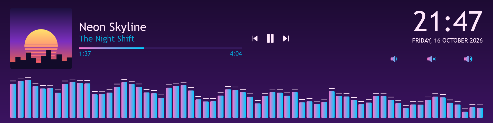

### Network
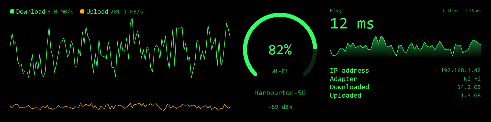

### Festive
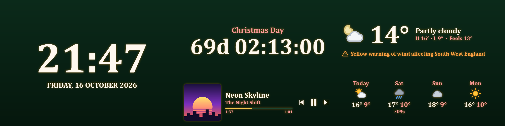

### Small Screen
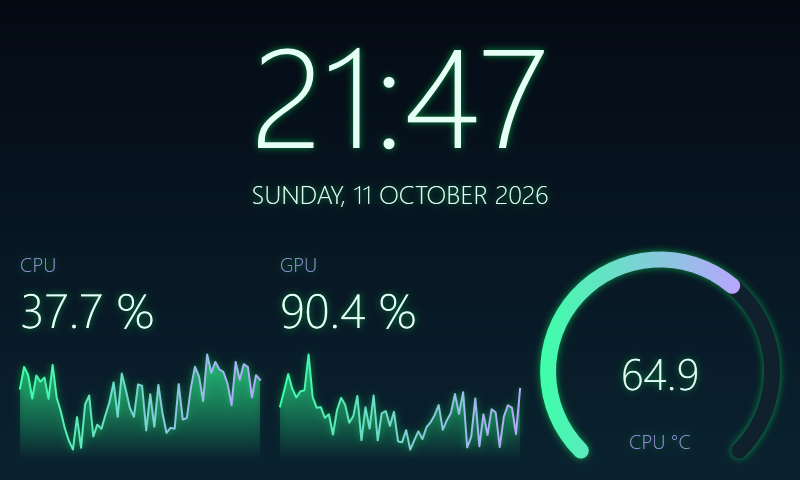

### USB Mini
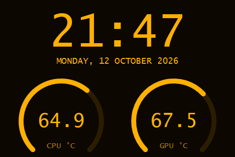

### Pocket
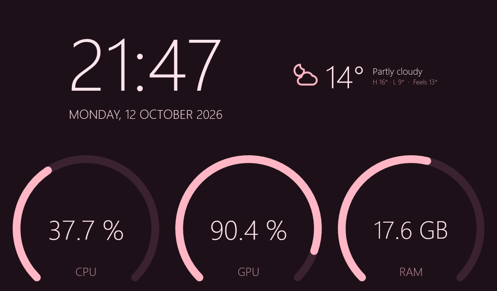

### Streamer
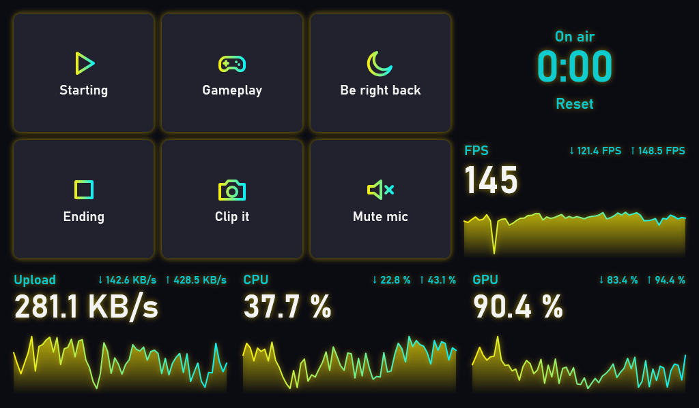

### Trick or Treat
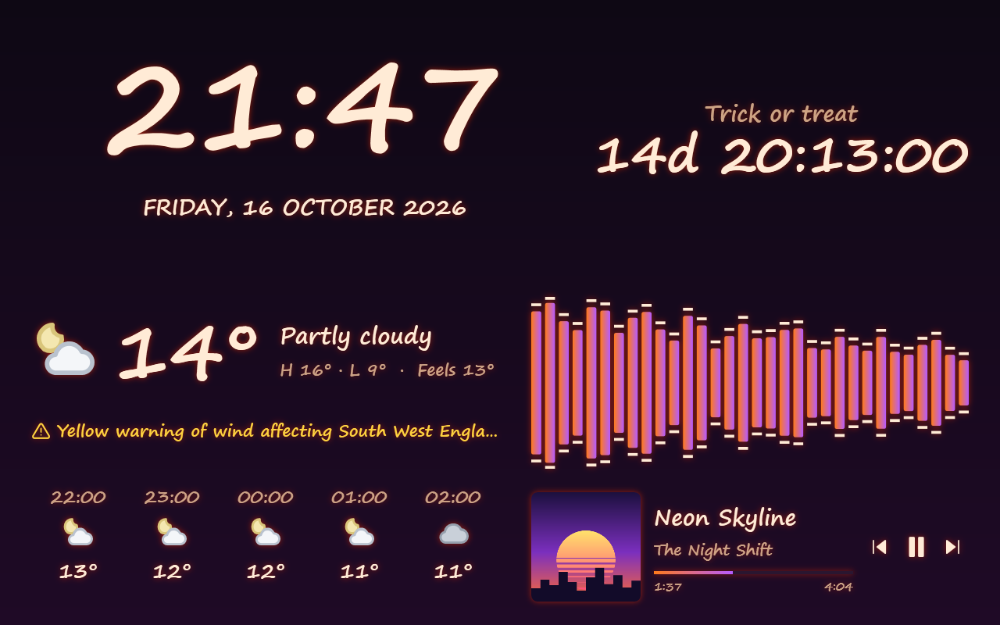

### Sim Rig
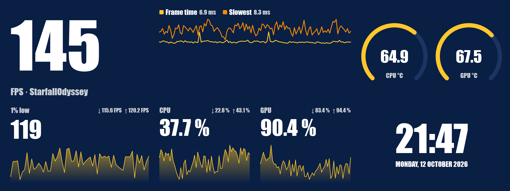

### Living Room
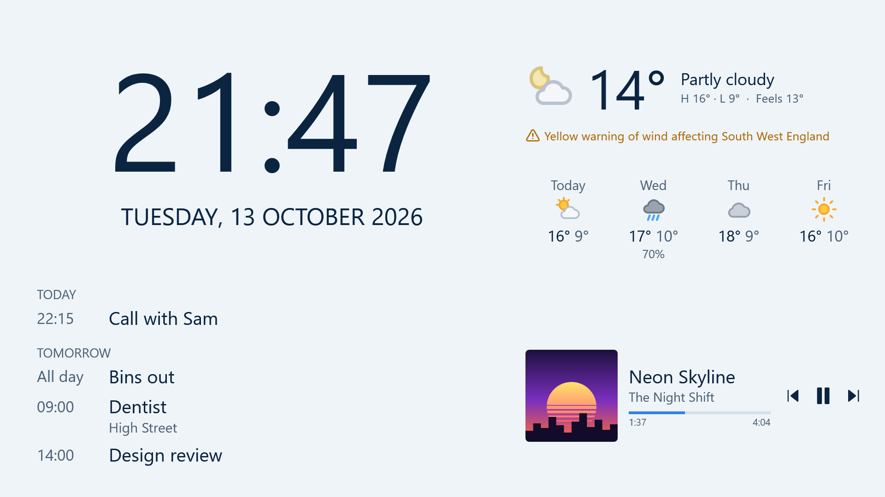

### Command Centre
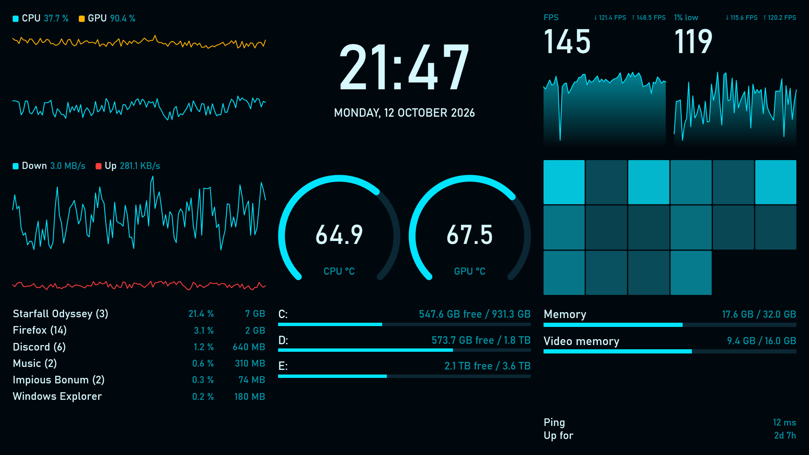

### Weather Station
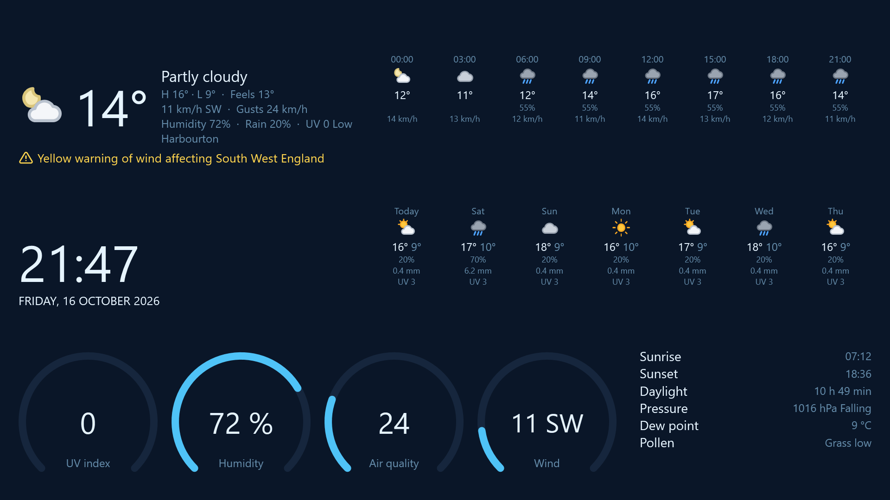

### News Desk
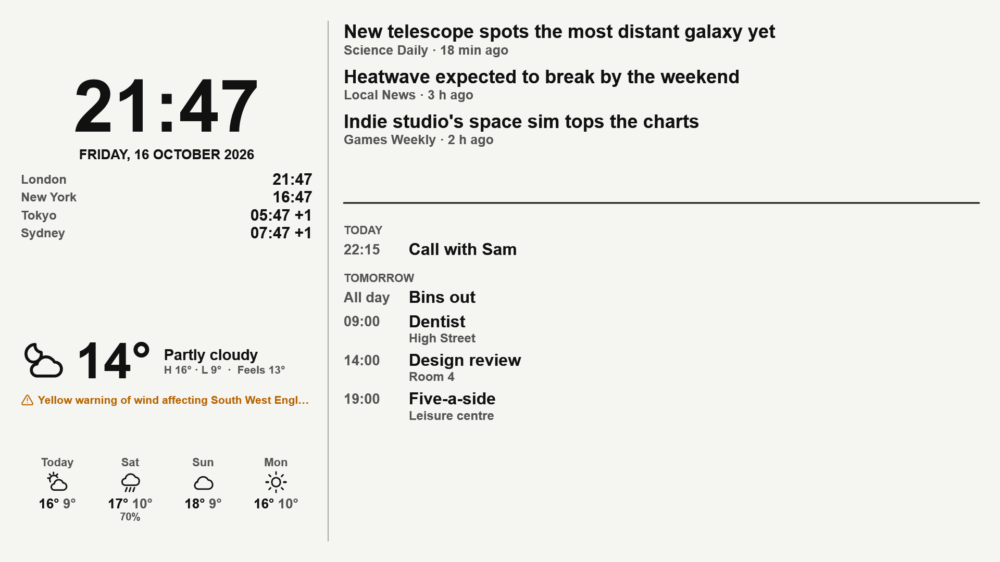

### Workstation
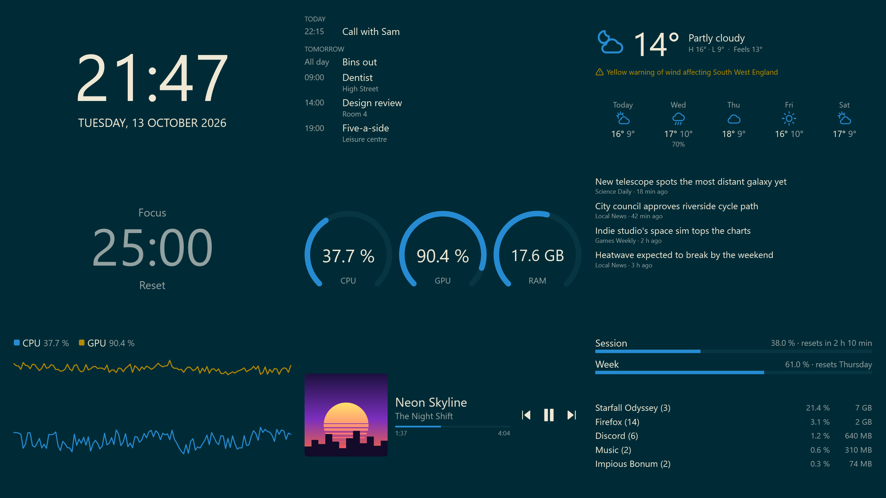

### Big Picture
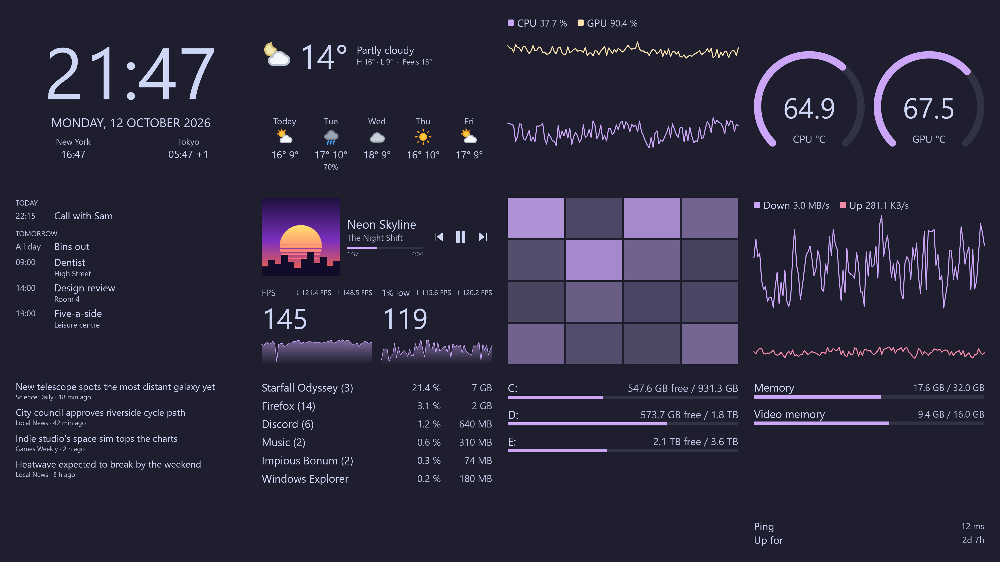

### Tower
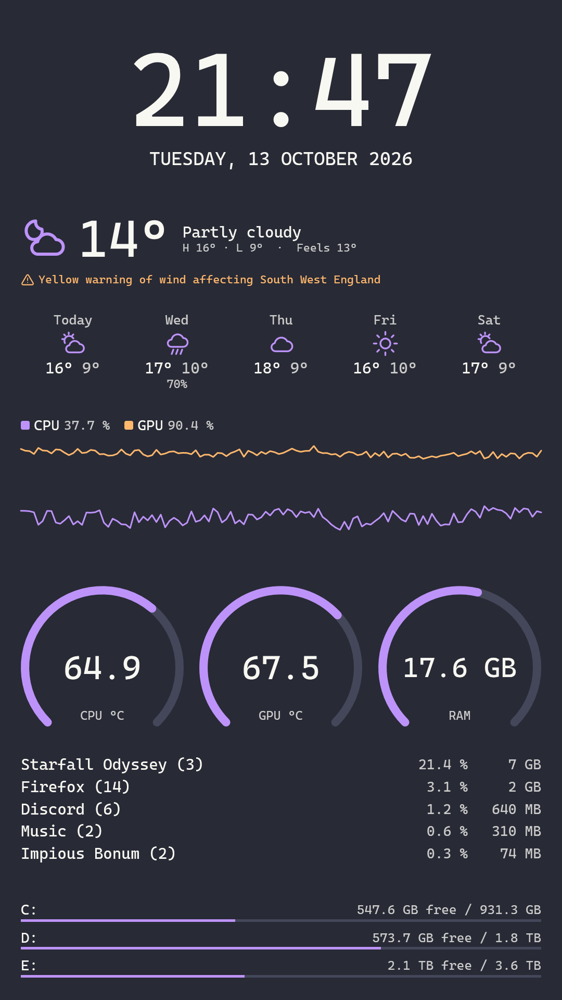

### Case Strip
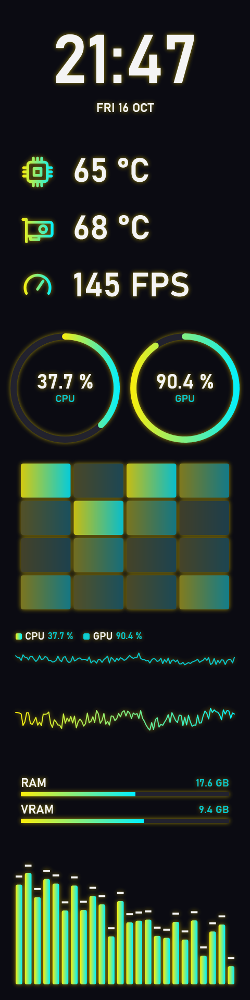

These are drawn with made-up readings by `build/screenshots.ps1`; in the app, the gallery shows each one with yours.

## Sharing a layout

1. In the layout editor, *Layouts ▾ → Export…* saves your layout as one `.ibl` file, with its font, background and
   pictures inside. (A plain layout `.json` works too, if it has no pictures or fonts.)
2. Add the file to this folder, and an entry for it in [`index.json`](index.json): its `name`, `file`, `author`, a
   one-line `description`, the canvas `width` and `height`, and how many `widgets` it has (not counting shapes and
   pictures).
3. Open a pull request. The tests check that every gallery layout opens and is valid. If you can, run
   `pwsh build/screenshots.ps1` to add a picture of it to `gallery/images`.
